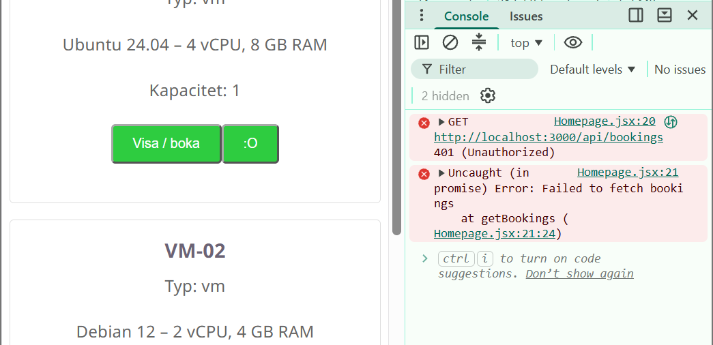
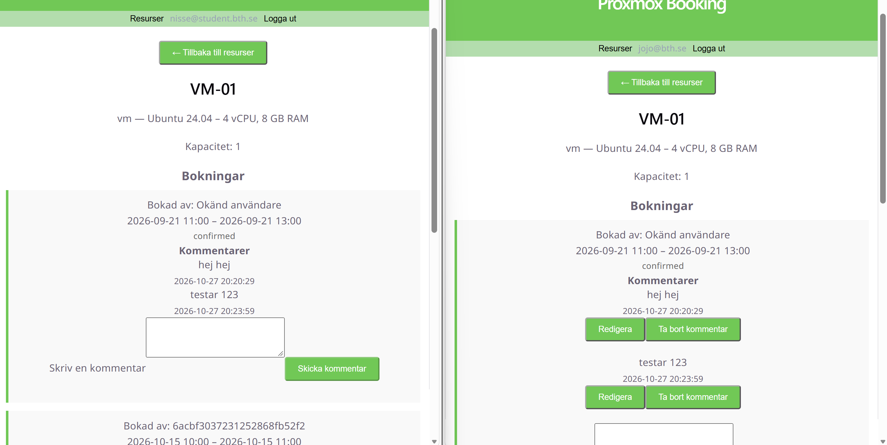

# dv1677-ht26-grupp6-frontend

## Gruppmedlemmar

| Namn | GitHub |
|------|--------|
| Johanna Johansson | @jojjan-johansson |
| Rebecka Corell    | @beckabeckis      |

## Om projektet

Frontend för grupp 6:s bokningssystem i kursen DV1677. Frontenden byggs med React och Vite och kommer att kommunicera med gruppens backend-API.

## Kör lokalt

```bash
git clone https://github.com/jojjan-johansson/dv1677-ht26-grupp6-frontend.git
cd dv1677-ht26-grupp6-frontend
cp .env.example .env
npm install
npm run dev
```

**Miljövariabler** (se .env.example):

| Variabel | Beskrivning |
|----------|-------------|
| VITE_API_URL | URL till backend-API:t |

## Bygga för produktion

```bash
npm run build
```

## Driftsatt

- Frontend: [https://jojjan-johansson.github.io/dv1677-ht26-grupp6-frontend/](https://jojjan-johansson.github.io/dv1677-ht26-grupp6-frontend/)
- Backend: [https://dv1677-geordi.nplab.bth.se/](https://dv1677-geordi.nplab.bth.se/)

## Tillvägagångssätt

Dokumentera löpande vad ni gjort och hur ni löst problem.

- Vecka 3: Vi började med att skapa en ren grundsida med React och Vite, skapade en .env fil och la sedan in .env i .gitignore

- Vecka 4: Vi migrerade backend från SQLite till MongoDB och anpassade resurser och bokningar till MongoDB. Backend gjordes om till ett JSON-API och frontend kopplades till API:t för att hämta och visa resurser. Vi lade även till API-tester med Vitest, Supertest och MongoDB Memory Server och delade upp app och server för att testerna skulle kunna köras utan att starta webbservern.

- Vecka 5: Vi containeriserade backend och MongoDB med Docker och driftsatte backend på gruppens VPS. GitHub Actions sattes upp för CI och automatisk deployment via GHCR och SSH. Secrets och deploy key konfigurerades för deployment. Backend publicerades via Caddy med HTTPS. Frontend konfigurerades för GitHub Pages med GitHub Actions och kopplades till den driftsatta backendens API. Routing anpassades för GitHub Pages projektadress.


## Krav 1

### I backend:

Vi har lagt till JWT_SECRET som en github secret med en randomiserad sträng, samt lagt in i .env för lokal testkörning. 

Vi har lagt till routes för att logga in och registrera sig där de tar emot email och lösenord. Register routen lägger in email och en, med hjälp av bcrypt, haschad version  av lösenordet i en ny användare i databasen och skickar tillbaka en signerad jwt token och ett user objekt. Login routen kollar om en user med den emailen finns och om det är ok så jämförs lösenorden med hjälp av bcrypt. Om allt stämmer så skickas det tillbaka en signerad jwt token och ett user objekt.

Vi har gjort en middleware som vi använder i booking routsen för att verifiera att den som anropar routsen är inloggad, samt inloggad som admin. Middlewaren har två funktioner, en som kollar att användaren är autentiserad, requireAuth, och en som kollar om användaren är admin, requireAdmin. requireAuth kollar först att headern på API-anropet är korrekt genom att kolla om den börjar med 'Bearer ' som den borde om den har en token med sig. Om det stämmer så tar den ut token från headern och med hjälp av jwt så verifieras token mot JWT_SECRET. Med hjälp av svaret från verifieringen så hämtas den aktuella användaren och kollar att användaren finns i databas. Om allt är okej så höjs inga varningar och routen som funktioner används i kan fungera som vanligt. requireAdmin kollar om användaren har rollen admin, om inte så höjs en varning annars så kan routen som funktioner används i kan fungera som vanligt.

Vi valde att alla användare kan se översikten över resurserna men behöver logga in för att se och hantera bokningar. Vi bestämde även att endast admin kan ta bort bokningar,  övriga användare kan endast avboka dem, och admin kan även se och hantare allas boknigar medans övriga användare endast kan hatera sina egna.


**Routes som kröver autentisering:**

- GET /bookings
- GET /bookings/resource/:id
- GET /bookings/:id
- POST /bookings
- POST /bookings/:id
- DELETE /booking/cancel/:id
- DELETE /booking/delete/:id (endast admin)

**Filer som har lagts till / ändrats:**

- controllers/authController.js
- middleware/auth.js
- routes/auth.js
- routes/bookings.js
- .env
- .env.example
- 

### I frontend:

Vi har lagt till en login sida och en registrera sida där användaren kan logga in eller registrera sig som en ny användare. 

Vi har lagt till en AuthContext.jsx med två funktioner, en för att logga in och en för att logga ut genom att lägga till username och token i localstorage respektive rensa dessa. Funktionerna, user och token läggs till i en kontext som används i pages för att enkelt kunna logga in och ut.
Vi har skapat ett auth api med en login funktion som skickar user och lösenord till backends login route med fetch och en funktion som gör motsvarande för att registrera ny användare.

Vi har uppdaterat booking api så att det skickas med en token i headern så att endast inloggade användare kan se, lägga till, ändra och avboka bokningar. Endast admin kan ta bort bokningar.

Vi har uppdaterat resource page för att använda korrekta api:er, lägga till avboka, ta bort och ändra bokning funktioner och se till att endast inloggade användare kan komma in på detaljvyn över varje resurs och dess bokningar och att endast admin kan se allas bokningar (övriga användare ser endast sina egna). Vi har även lagt till en EditBocking page för att kunna editera bokningar.


**Filer som har lagts till / ändrats:**

- src/api/auth.js
- src/api/bookings.js
- src/context/AuthContext.jsx
- src/pages/Login.jsx
- src/pages/Register.jsx
- src/pages/Resource.jsx
- src/pages/EditBooking.jsx
- src/App.jsx

### Anrop utan token

Här har vi temporärt lagt in en funktion i frontend som hämtar alla bokningar men utan token som behövs för att autentiseras i backend (funktionen anropas i en temporär knapp):

Funktionen:


Resultat i devtools (ger error 401):



## Krav 2 – WebSockets och realtidsuppdateringar

### I backend:

Vi har installerat Socket.io för att kunna skicka realtidsuppdateringar mellan backend och frontend när bokningar förändras.

Vi har uppdaterat `server.js` så att Express och Socket.io använder samma HTTP-server. Vi har även lagt till CORS-konfiguration för att frontend ska kunna ansluta till Socket.io-servern.

Vi har implementerat olika events för att hantera anslutningar och uppdateringar. När en användare ansluter till Socket.io-servern körs eventet `connection`. Vi har även lagt till ett `join`-event som gör att användaren kan ansluta till ett specifikt rum (room).

Vi har valt att skapa ett rum för varje resurs med namnet `resource:${resourceId}`. På så sätt skickas uppdateringar till de användare som tittar på samma resurs.

När en bokning skapas skickas eventet `booking:created` till det aktuella rummet.

Vi har även lagt till hantering av `disconnect`, som körs när en användare kopplar från Socket.io-servern.

**Events som används:**

| Event | Funktion |
|-------|----------|
| `connection` | Hanterar när en klient ansluter till servern. |
| `join` | Ansluter klienten till ett rum för en specifik resurs. |
| `disconnect` | Hanterar när klienten kopplar från servern. |
| `booking:created` | Meddelar att en ny bokning har skapats. |
| `booking:updated` | Frontend lyssnar efter ändringar av bokningar. |
| `booking:deleted` | Frontend lyssnar efter borttagna bokningar. |

**Filer som har lagts till / ändrats:**

- `server.js`
- `app.js`
- `routes.mjs`
- `package.json`
- `package-lock.json`

### I frontend:

Vi har installerat `socket.io-client` och uppdaterat `Resource.jsx` för att kunna ta emot realtidsuppdateringar från backend.

Vi använder Reacts `useEffect` för att skapa en Socket.io-anslutning när en inloggad användare öppnar en resurs.

När anslutningen har etablerats skickas ett `join`-event med resursens ID så att användaren ansluts till rätt rum.

Vi har lagt till eventlyssnare för:

- `booking:created`
- `booking:updated`
- `booking:deleted`

När något av dessa events tas emot anropas funktionen `handleBookingChange()`, som hämtar bokningarna på nytt från backend.

På så sätt kan bokningslistan uppdateras automatiskt utan att användaren behöver ladda om webbsidan.

Vi har även implementerat cleanup i `useEffect`.

När användaren lämnar sidan eller byter resurs tas eventlyssnarna bort med `socket.off()` och anslutningen stängs med `socket.disconnect()`.

Detta förhindrar att gamla anslutningar ligger kvar och att samma event hanteras flera gånger.

**Filer som har lagts till / ändrats:**

- `src/pages/Resource.jsx`
- `package.json`
- `package-lock.json`

### Testning

Vi har öppnat bokningssystemet i två olika webbläsarfönster och loggat in med två olika användare.

Båda användarna har öppnat samma resurs, VM-01.

Vi har kontrollerat att båda användarna kan se samma kommentarer till en bokning.

I testet visas kommentarerna "hej hej" och "testar 123" med samma tidsstämplar i båda webbläsarfönstren.

Vi har även kontrollerat att användarna har olika behörigheter. I det ena fönstret visas knappar för att redigera och ta bort kommentarer, medan det andra fönstret endast visar kommentarerna och formuläret för att skriva en ny kommentar.

**Resultat:**

Testet visar att två olika användare kan hämta och visa samma information från backend.

För att verifiera själva realtidsfunktionen behöver vi även kontrollera att en bokning som skapas eller ändras i det ena fönstret uppdateras automatiskt i det andra utan att sidan laddas om.

**Bild från testningen:**

Resultat från testet:




## Krav 3

### I backend:

Vi har lagt till ett kommentarsystem där användare kan skapa, läsa, redigera och radera kommentarer kopplade till bokningar.

Kommentarerna sparas i en egen collection i MongoDB som heter `comments`. Varje kommentar kopplas till rätt bokning genom `booking_id`.

En kommentar innehåller ett eget ID (`_id`), bokningens ID (`booking_id`), ID för användaren som skrivit kommentaren (`author`), kommentarens text (`text`) och datum och tid när kommentaren skapades (`created_at`). När en kommentar redigeras läggs även `updated_at` till.

Vi har skapat `routes/comments.js` där vi hanterar API-anropen för kommentarerna. Vi har lagt till routes för att hämta alla kommentarer, hämta kommentarer för en specifik bokning eller användare, hämta en enskild kommentar samt skapa, redigera och radera kommentarer.

Vi har lagt till validering som kontrollerar att ID:n har ett giltigt MongoDB ObjectId-format, att kommentarstexten inte är tom och att den inte innehåller fler än 2 000 tecken.

När en kommentar skapas kontrollerar vi också att bokningen finns i databasen.

Alla kommentarsroutes använder `requireAuth` från vår befintliga autentiseringsmiddleware. Det innebär att användaren måste vara inloggad för att kunna använda API:t.

Vi har även lagt till funktionen `canManageComment()` som kontrollerar om användaren har rätt att redigera eller radera en kommentar. Endast den som har skrivit kommentaren eller en administratör får göra detta.

Om en annan användare försöker redigera eller radera kommentaren returnerar backend `403 Forbidden`.

För att uppdatera kommentarerna i realtid har vi använt Socket.io från krav 2.

När en kommentar skapas, redigeras eller raderas skickas en Socket.io-händelse till det rum som tillhör bokningens resurs.

Vi använder följande events:

- `comment:created` – när en kommentar skapas.
- `comment:updated` – när en kommentar redigeras.
- `comment:deleted` – när en kommentar raderas.

Händelserna skickas efter respektive databasoperation och innehåller bokningens ID och kommentarens ID.

Frontend kan då hämta de uppdaterade kommentarerna via API:t.

När en bokning avbokas ändras dess status till `cancelled` i databasen i stället för att bokningen tas bort. Kommentarerna finns därför kvar och är fortfarande kopplade till bokningen.

Vi har inte lagt till någon separat automatisk radering av kommentarer vid permanent radering av bokningar.

**Filer som har lagts till / ändrats:**

- `routes/comments.js` – ny fil för API-routes, validering, behörighetskontroll och Socket.io-events för kommentarer.
- `app.js` – uppdaterad med import och registrering av `commentsRouter`.


### I frontend:

Vi har skapat komponenten `BookingComments.jsx` där användare kan läsa, skapa, redigera och radera kommentarer på bokningar.

Komponenten hämtar kommentarerna från backend och visar dem under respektive bokning.

Vi har lagt till ett textfält där användaren kan skriva och skicka en ny kommentar.

Vi har även lagt till funktioner för att redigera och radera befintliga kommentarer.

Knapparna för att redigera och radera visas endast för kommentarens författare eller en administratör. Backend gör dessutom en egen behörighetskontroll.

Vi visar datum och tid när kommentaren skapades. Om kommentaren har ändrats visas även att den är redigerad.

Vi har uppdaterat `Resource.jsx` så att kommentarskomponenten visas tillsammans med bokningarna på resurssidan.

Vi har också lagt till realtidsuppdateringar för kommentarerna genom Socket.io.

I `BookingComments.jsx` ansluter vi till resursens Socket.io-rum och lyssnar på `comment:created`, `comment:updated` och `comment:deleted`.

När en händelse tas emot kontrollerar vi vilken bokning den gäller och hämtar kommentarerna på nytt från backend om händelsen gäller den aktuella bokningen.

Det innebär att användare som tittar på samma resurs kan se förändringar i kommentarerna utan att behöva ladda om sidan.

Genom att hämta kommentarerna på nytt via API:t undviker vi också att lägga till samma kommentar flera gånger från Socket.io-händelser.

När komponenten tas bort stängs Socket.io-anslutningen och lyssnarna tas bort.

**Filer som har lagts till / ändrats:**

- `src/components/BookingComments.jsx` – ny komponent för att visa, skapa, redigera och radera kommentarer samt hantera realtidsuppdateringar.
- `src/pages/Resource.jsx` – uppdaterad för att visa kommentarskomponenten tillsammans med bokningarna.


### Test av kommentarer:

Vi har manuellt testat att skapa, läsa, redigera och radera kommentarer på en bokning.

Vi har även testat realtidsuppdateringarna genom att öppna samma resurs i två olika webbläsarfönster med två olika inloggade användare.

När vi skapade en kommentar i det ena fönstret visades den automatiskt i det andra utan att sidan behövde laddas om.

Vi har också kontrollerat behörigheterna i gränssnittet genom att använda två olika användarkonton.

Den användare som hade skrivit kommentarerna kunde se knapparna för att redigera och radera dem, medan den andra användaren kunde läsa kommentarerna men inte såg dessa knappar.

Vi har även granskat behörighetskontrollen i backend och kontrollerat att koden returnerar `403 Forbidden` när en användare saknar rätt att redigera eller radera en kommentar.

Vi har däremot inte genomfört ett separat API-test där en obehörig användare försöker ändra eller radera någon annans kommentar direkt.

**Se bilden under krav 2**, där två användare är inloggade samtidigt och tittar på samma resurs. Bilden visar kommentarerna och skillnaden i vilka knappar användarna har tillgång till.

Själva realtidsuppdateringen utan omladdning har vi verifierat genom manuell testning.


## Krav 4 - Bokningssystem: bokningslogik

### I Backend

Vi har skapat en fil, overlap.js, med två funktioner. En som heter intervalsOverlap och kollar att två bokningar inte är överlappar varandra, overlap villkoret ser ut såhär:

> ```a.start_time < b.end_time && b.start_time < a.end_time```

Den andra heter findConflicts och kollar i databasen att det inte redan finns en bokning på den nya bokningens tider.

Vi har även skapat en fil, policy.js, som har en funktion som heter controlBookingPolicy. Den tar en bokning och kollar tre saker; 1: att bokningen inte är mer än fyra timmar, 2: att bokningen inte startar i dåtiden, 3: att användaren inte har mer än 3 bokningar. Detta så att det inte blir för mycket eller för långa onödiga bokningar.

I getBooking och editBooking routesen så används findConflicts och controlBookingPolicy funktionerna innan bokningen bokas av brokern och läggs in i databasen för att se att bokningen inte bryter mot några av dessa policys eller skapar en konflikt. Om bokningen skulle bryta mot en policy eller skapa en konflikt så avbryts routen med statuskoden 409 eftersom API anropet fungerade bra men att bokningen inte gick igenom på grund av konflikter med existerande bokningar eller policyn. Statuskoden 409 passar därför bra enligt [MDN Web Docs](https://developer.mozilla.org/en-US/docs/Web/HTTP/Reference/Status/409):

>"The HTTP 409 Conflict client error response status code indicates a request conflict with the current state of the target resource."

Vi har skapat en till fil, availability.js, som kollar alla en angiven dags lediga tider från databasen på en angiven resurs och skickar tillbaka lediga tid-slotter i en timmes intervaller. Funktionen tar starttiden 8:00 och sluttiden 18:00 (öppettiderna) och hämtar alla bekräftade bokningar för den dagen. Sedan skapar den alla tid-slotter som får plats mellan öppettiderna och slutligen jämförs slotsen med bokningarna med hjälp av intervalsOverlap funktionen från overlap.js. De slotsen får available: true om de är lediga och available: false annars.
Denna funktion används i en route som tar emot resource id och date och skickar tillbaka de lediga slotsen, getAvailability.

**Filer som har lagts till / ändrats:**

- domian/availability.js
- domian/overlap.js
- domian/policy.js
- routes/booking.js
- routes/resources.js


## I Frontend

Vi har lagt in en ny API funktion som anropar getAvailability från backend. I Resource.jsx så hämtas dagens datum som tillsammans med den aktuella resursens id skickas med i ett anrop till getAvailability funktionen. Svaret med slots sparas i en variabel som använss i formuläret för att boka en ny tid. För varje slot så kollas först att början på slot-tiden inte har passerat i nuvarande tid och sedan skapad en div i ett rutnät med start och slut tid. Datan available kollas på sloten och om den är true så blir diven klickbar och om användaren väljer denna tid så sparas start och slut tiden från sloten som skickas med som bokningens start och slut tid. Om användaren väljer ett annat datum så laddas slotsen om med det nya datumet.

**Filer som har lagts till / ändrats:**

- src/api/resources.js
- src/pages/Resources.jsx